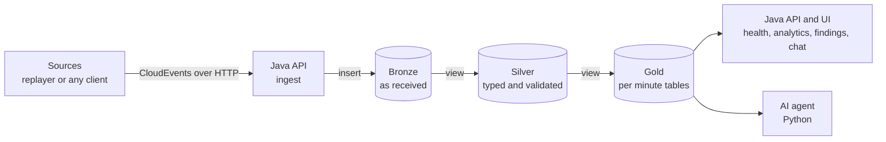

# Bromo

[](https://openjdk.org/projects/jdk/21/)
[](https://spring.io/projects/spring-boot)
[](https://clickhouse.com/)
[](LICENSE)

**A self-hosted streaming ELT pipeline into ClickHouse, with an AI agent that detects and explains data and anomalies.**

Send events as CloudEvents over HTTP. Bromo loads them into ClickHouse, models them inside the
warehouse in three layers (bronze, silver, gold), and shows pipeline health, analytics, and findings in a web UI. A Python agent watches
the gold tables, detects anomalies with statistics, and explains anomalies and any selected data with read-only SQL. You can ask questions in the web
chat.

*Named after Mount Bromo. Like volcanologists measure emissions to understand a mountain, Bromo measures your events to
make them understandable.*

> **Project status: work in progress.** Implemented: the ingest API, the three warehouse layers, the data contract,
> and the replayer. The read API, web UI, anomaly agent, and chat described in the docs are not built yet. Measurements
> so far are single machine baselines in [benchmarks/](benchmarks/README.md), and this README makes no capacity claims.

## What you will see

| View | Shows |
|---|---|
| Pipeline health | Throughput, freshness, end-to-end lag, reject rate, and reconciliation between stages |
| Analytics | Volume, amounts, and rates per minute with breakdowns, read from the gold layer |
| Findings and chat | Anomalies the agent found, each with the SQL evidence, and a chat that answers with the SQL it ran |

## Architecture



- **Java (`bromo-app`)** owns ingest, the read API, auth, rate limits, the spend cap, and the UI. Organized in feature
  modules.
- **Python (`bromo-agent`)** owns detection and the agent. It is internal and never exposed.
- **ClickHouse** is the only datastore. Transformation is ELT with materialized views.

Details: [docs/ARCHITECTURE.md](docs/ARCHITECTURE.md), [docs/DATA.md](docs/DATA.md),
[docs/AGENT.md](docs/AGENT.md).

## Warehouse layers

Bromo stores data in three layers, the medallion layout. Each layer is its own ClickHouse database with several tables.
A layer is a stage of data quality, not a deployment environment.

| Layer | What it is |
|---|---|
| **Bronze** | Events exactly as the ingest API received them, unmodified and append-only, kept for a short time. Because nothing is interpreted here, a bug in later logic never loses data. |
| **Silver** | The clean copy: events parsed into typed columns, validated, and deduplicated. Rows that fail validation are kept in a separate table with a reason. |
| **Gold** | Per minute tables built for questions (volumes, sums, percentiles, distinct counts). The API, the UI, and the anomaly detector read gold. |

Details, table lists, and rebuild rules are in [docs/DATA.md](docs/DATA.md#warehouse-layers).

## Make it yours

Everything specific to your data lives in one file, [config/data-contract.yml](config/data-contract.yml): the event rules,
which fields become typed columns, the layer names, the gold tables, and the metrics. Edit it, run
`./gradlew :bromo-app:generateWarehouseSql`, and the ingest validation, the ClickHouse SQL, the metric list, the agent's
context, and the tests all follow. The tests build their events from a sample in the same file, so they work for any
contract. See [docs/DATA.md](docs/DATA.md#the-data-contract).

## Design choices

| Choice | Why | Evidence |
|---|---|---|
| Batched inserts into ClickHouse | Insert performance depends on batch size | [Cloudflare DNS analytics](https://blog.cloudflare.com/how-cloudflare-analyzes-1m-dns-queries-per-second/) |
| One materialized view per query shape | Match keys to queries, keep reads fast | [Cloudflare HTTP analytics](https://blog.cloudflare.com/http-analytics-for-6m-requests-per-second-using-clickhouse/) |
| Schema-agnostic events with typed hot columns | Flexible input, fast filters | [Uber logging](https://www.uber.com/blog/logging/) |
| Statistics detect, LLM explains | Cost, latency, testability | [Meta incident response](https://engineering.fb.com/2024/06/24/data-infrastructure/leveraging-ai-for-efficient-incident-response/) |
| Read-only SQL tools, table comments as docs | Limits agent risk and wrong SQL | [ClickHouse agentic analytics](https://clickhouse.com/blog/agentic-analytics-ask-ai-agent-and-remote-mcp-server-beta-launch) |
| Golden-set evaluation | Measure the agent instead of trusting it | [Uber QueryGPT](https://www.uber.com/blog/query-gpt) |

Where a source does not fully apply, [docs/DECISIONS.md](docs/DECISIONS.md#prior-art-and-its-limits) says so.

## Quick start

Prerequisites: Docker Engine 25+ (or OrbStack), JDK 21+, Python 3.12+ with `uv` for the replayer.

```bash
git clone https://github.com/raihanpka/streaming-elt-clickhouse-with-ai
cd streaming-elt-clickhouse-with-ai
cp .env.example .env            # then fill in the required secrets, for example with: openssl rand -hex 16
docker compose --env-file .env -f infra/docker/docker-compose.yml up -d
set -a; . ./.env; set +a
./gradlew :bromo-app:bootRun    # API on :8080
```

Send an event:

```bash
curl -X POST http://localhost:8080/api/v1/events \
  -H "Content-Type: application/cloudevents+json" \
  -H "Authorization: Bearer $BROMO_API_KEY" \
  -d '{"specversion":"1.0","id":"evt_001","source":"my-app","type":"com.example.payment.v1",
       "time":"'"$(date -u +%Y-%m-%dT%H:%M:%SZ)"'","data":{"amount":42.5,"label":"ok"}}'
```

Replay a dataset slice and check the layers: see [tools/replayer/README.md](tools/replayer/README.md) and
`infra/clickhouse/maintenance/run.sh reconcile`. The read API, UI, and agent are described in
[docs/API.md](docs/API.md) and [docs/AGENT.md](docs/AGENT.md) but are not implemented yet.

## Data

Bromo is demonstrated with a replayed slice of the OnTime flights dataset (US flights with delay causes from the
Bureau of Transportation Statistics, hosted by ClickHouse), plus a synthetic generator that injects known anomalies.
The causes in the data let an answer such as "delays rose in Texas because of weather" be checked. Datasets are read
through ClickHouse or downloaded and never committed. See [docs/DATA.md](docs/DATA.md#datasets) for the dataset, slicing,
and license notes.

## Repository layout

```
bromo-app/        Java API, ingest, UI hosting
bromo-agent/      Python detector, agent, evaluation        (planned)
bromo-ui/         Frontend source                           (planned)
proto/            gRPC contract                             (planned)
tools/replayer/   Dataset replay and generator              (planned)
infra/            Docker Compose, ClickHouse SQL, Caddy
benchmarks/       Reproducible measurements
docs/             Architecture, data, agent, API, operations, decisions
```

## Documentation

| Document | About |
|---|---|
| [docs/ARCHITECTURE.md](docs/ARCHITECTURE.md) | Components, flows, feature modules, failure modes |
| [docs/DATA.md](docs/DATA.md) | Warehouse layers, tables, users, datasets |
| [docs/AGENT.md](docs/AGENT.md) | Detector, agent, safety, evaluation |
| [docs/API.md](docs/API.md) | HTTP, event, and gRPC contracts |
| [docs/OPERATIONS.md](docs/OPERATIONS.md) | Deployment, configuration, operational conventions |
| [docs/DECISIONS.md](docs/DECISIONS.md) | Decision records and prior art |
| [benchmarks/](benchmarks/README.md) | Performance and evaluation results |

## Out of scope

Multi-shard clusters, Flink or Spark, a BI tool, agent actions that change data, per-event LLM calls,
GraalVM native images, and Helm charts.

## Contributing

Read [CONTRIBUTING.md](CONTRIBUTING.md) and [AGENTS.md](AGENTS.md). Report security issues as described in
[SECURITY.md](SECURITY.md). This project follows the [Code of Conduct](CODE_OF_CONDUCT.md).

## License

[MIT License](LICENSE).
