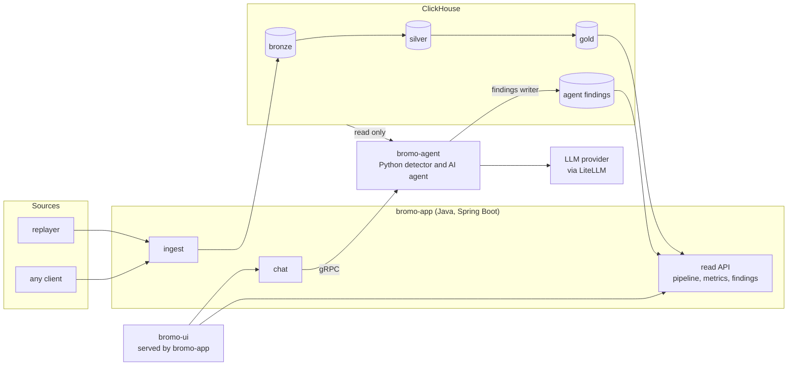
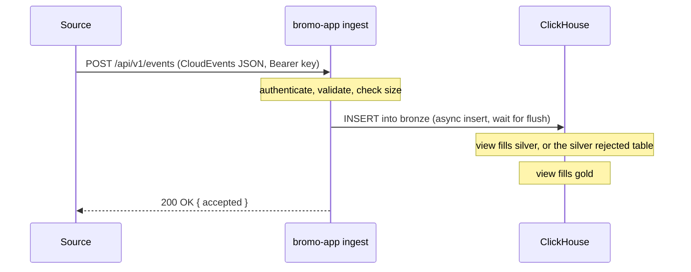

# Architecture

Bromo is a streaming ELT pipeline into ClickHouse with a Java API and UI on top and a Python AI agent that
investigates anomalies. This document is the canonical architecture reference.

> **Status:** implemented: ingest, the three warehouse layers, the data contract, and the replayer. The read API, UI,
> agent, and chat are the target design and are not built yet.

## 1. Principles

1. **Pipeline first.** Raw events land in the warehouse, are cleaned and modeled inside it, and only then feed
   analytics and the agent.
2. **One datastore.** ClickHouse holds the bronze, silver, and gold layers and the agent findings.
3. **ELT, not ETL.** Load first, transform inside the warehouse with materialized views, layer by layer.
4. **Feature modules.** The Java backend is organized by feature. Modules do not import each other.
5. **Abstraction at real boundaries only.** An interface needs two real implementations or a process boundary.
6. **Safety in the database.** Read-only access for the agent is enforced by ClickHouse, not by a prompt.
7. **Measured claims.** Every performance or accuracy statement links to a reproducible benchmark.

## 2. System context



## 3. Components

| Component | Language | Responsibility | Talks to |
|---|---|---|---|
| `bromo-app` | Java 21, Spring Boot 4.1 | Ingest API, read API, chat gateway, auth, rate limit, spend cap, serves the UI | ClickHouse (insert and read), `bromo-agent` (gRPC) |
| `bromo-agent` | Python 3.12 | Detector loop, AI agent, gRPC server, evaluation | ClickHouse (read only and findings writer), LLM provider |
| `bromo-ui` | TypeScript | Three views: pipeline health, analytics, findings and chat | `bromo-app` HTTP API only |
| `tools/replayer` | Python | Replays dataset slices, generates synthetic events with an anomaly manifest | `bromo-app` ingest API |
| ClickHouse | Single node | Storage, ELT, rollups, findings | |
| Caddy | | TLS and rate limit on the public VPS | |

The Python agent is never exposed to the internet. Only `bromo-app` calls it, over the internal network.

There is no message broker in this version. Ingest writes straight to ClickHouse using asynchronous inserts that are
acknowledged after the flush. See [DECISIONS.md](DECISIONS.md).

## 4. Flows

### 4.1 Ingest



`200` means the events are stored in bronze and the materialized views have run for that insert. If ClickHouse is unavailable the response is `503` and the client retries. Query latency after the flush is measured and published in [benchmarks/](../benchmarks/README.md).

### 4.2 Detection and findings

1. The detector queries a gold table every `DETECT_INTERVAL_SECONDS` and scores each series with a robust z-score (median and MAD).
2. A candidate above the threshold starts one agent run with a hard budget.
3. The agent investigates with read-only SQL and returns a structured finding.
4. The finding is written to `agent_findings` by a separate write-only user.
5. `GET /api/v1/findings` reads it and the UI shows it. An optional webhook can notify.

### 4.3 Chat

1. The browser calls `POST /api/v1/chat` with a token.
2. `bromo-app` checks the token, the per-token rate limit, and the daily spend cap.
3. `bromo-app` calls the `Chat` gRPC method on `bromo-agent` and streams events back as Server-Sent Events.
4. The answer includes the SQL that was run.

## 5. Java backend: feature modules

```
bromo-app/src/main/java/io/bromo/
  ingest/      IngestController, IngestService, RawEventWriter, CloudEventMapper, dto
  pipeline/    PipelineController, PipelineStatusQuery, dto
  metrics/     MetricsController, MetricRegistry, MetricsQuery, dto
  findings/    FindingsController, FindingsQuery, dto
  chat/        ChatController, ChatService, AgentClient, GrpcAgentClient, RateLimiter, SpendGuard, dto
  shared/      ProblemDetailsHandler, ClickHouseConfig, BearerAuthFilter, TimeRange
  bootstrap/   BromoApplication, configuration properties
```

Rules (checked by ArchUnit):

- A module does not import another module.
- `shared` does not import any module.
- Only `bootstrap` knows every module.
- Controllers contain no SQL. Services and queries contain no HTTP types.

The only interface by design is `AgentClient`, the process boundary to the Python agent, which tests replace with a fake. Everything else is a concrete class.

There is no separate `bromo-core` module and no `domain/application/infrastructure/web` layering. A single deployable does not need them.

## 6. Python agent

```
bromo-agent/src/bromo_agent/
  detector/     robust z-score and MAD scoring (pure functions), scheduler
  agent/        investigation loop, tool allowlist, budget, prompts
  serving/      gRPC server (Chat), health
  sinks/        findings writer, optional webhook
  evaluation/   scoring against the anomaly manifest
  llm/          LiteLLM wrapper, the only place that names a model
  settings.py   typed settings read once at startup
```

Details in [AGENT.md](AGENT.md).

## 7. Warehouse

Three layers, all inside ClickHouse: bronze (events as received), silver (parsed, typed, validated), gold (per minute
rollups). Each layer is its own database with several tables. What each layer is, and the data contract that
describes them, are in [DATA.md](DATA.md).

## 8. Delivery guarantees

| Concern | Behavior |
|---|---|
| Acknowledgement | `200` is returned only after the insert is flushed to ClickHouse. |
| Retries | Clients retry on `503` and on network errors. Retries are safe, duplicates collapse. |
| Ordering | Not guaranteed. Event time is stored and queries use event time. |
| Duplicates | Silver collapses duplicates by key on merge. Gold may over-count by the duplicate rate until a rebuild. The rate is measured and published. |
| Bad data | Rows that fail parsing or validation go to the silver rejected table with a reason. Nothing is dropped silently. |
| Backpressure | If ClickHouse is unavailable, ingest returns `503`. There is no durable buffer, a client that stops retrying loses its events. |
| Replay | Silver and gold are rebuilt from bronze with a documented command. Source data can be replayed through the ingest API. |

## 9. Failure modes

| Failure | Effect | Handling |
|---|---|---|
| ClickHouse down | Ingest and read API return `503` | Clients retry with backoff. Readiness fails. |
| Malformed event | Rejected with `400` at the API, or stored in the silver rejected table if it passes the API check | Reason is recorded. Reject ratio is shown in pipeline status. |
| LLM provider down | No new findings, chat returns an error | The detector still scores and stores candidates. |
| Budget exhausted | The run ends with a `budget_exhausted` result | The finding is marked incomplete and never hangs. |
| Spend cap reached | Chat is refused until the next day | The UI shows a clear message. |

## 10. Security

Summary here, details in [SECURITY.md](../SECURITY.md) and [AGENT.md](AGENT.md).

- Ingest: bearer key. Chat: bearer token, rate limit, spend cap.
- ClickHouse users: `ingest_writer` (insert on bronze only), `api_reader` (Java reads), `agent_reader` (Python, read
  only, limited), `findings_writer` (Python).
- The browser never sends SQL.
- Event content reaching the LLM is treated as data.

## 11. Performance targets

Goals are set before measurement and revised after it. Baselines measured so far are in [benchmarks/](../benchmarks/README.md):

| Goal | Target on the reference VPS (12 GB RAM, 2 CPU, arm64) |
|---|---|
| Event stored and queryable after the request, 100k event slice | p95 under 5 seconds |
| Analytics endpoint query time | under 300 ms |
| Agent finding after an injected anomaly | within one detection interval plus the agent run |

Results and commands go to [benchmarks/](../benchmarks/README.md).

## 12. Technology

| Concern | Choice |
|---|---|
| Backend | Java 21, Spring Boot 4.1, Gradle with version catalog |
| Warehouse | ClickHouse (version pinned, arm64 image required) |
| Agent | Python 3.12, LiteLLM, `mcp-clickhouse`, gRPC |
| Contract | CloudEvents 1.0 for events, protobuf for internal gRPC |
| Quality | Spotless (google-java-format), ArchUnit, JUnit 5, Testcontainers, ruff, mypy, pytest |
| Observability | Micrometer, Prometheus endpoint, structured JSON logs |

## 13. Customizing

Bromo is meant to be adapted to your data without rewriting code. `config/data-contract.yml` is the single source for the
event rules, the typed fields, the three layers, the gold tables, and the metrics. The SQL, the validation, the metric
list, the agent's context, and the tests are all derived from it. Extension points for storage and input formats are
marked `CUSTOMIZE` in the code. The workflow and the full list are in [DATA.md](DATA.md#the-data-contract).

## 14. Deliberately not in scope (for now)

A message broker, multi-shard clusters, Flink, Spark, Cassandra, PostgreSQL, Redis, Helm, a BI
tool, chat channel integrations beyond the web UI, agent actions that change data, and per-event LLM calls. Reasons are in [DECISIONS.md](DECISIONS.md).
